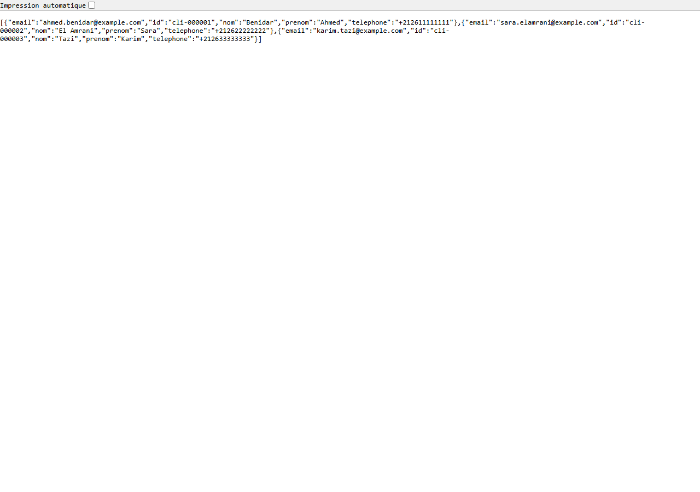
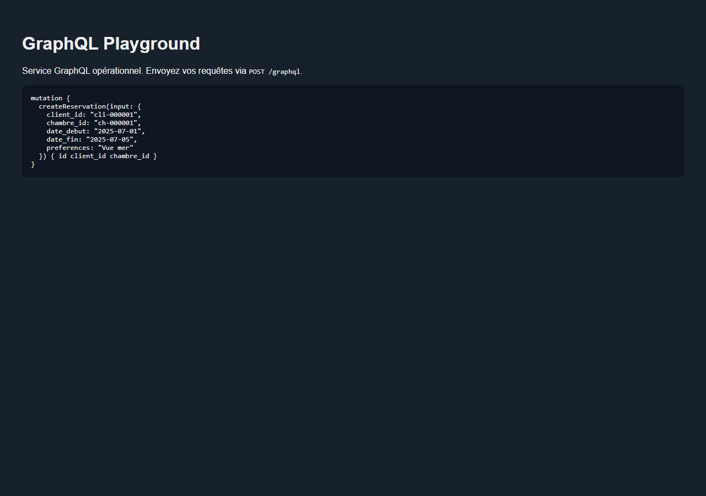
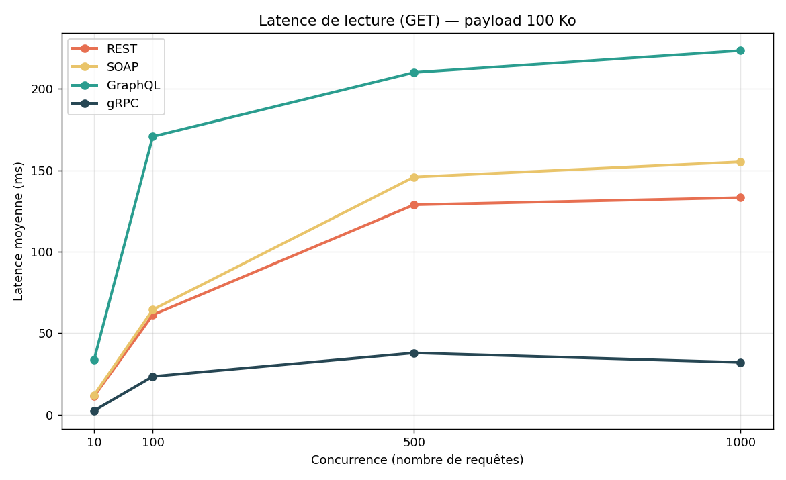
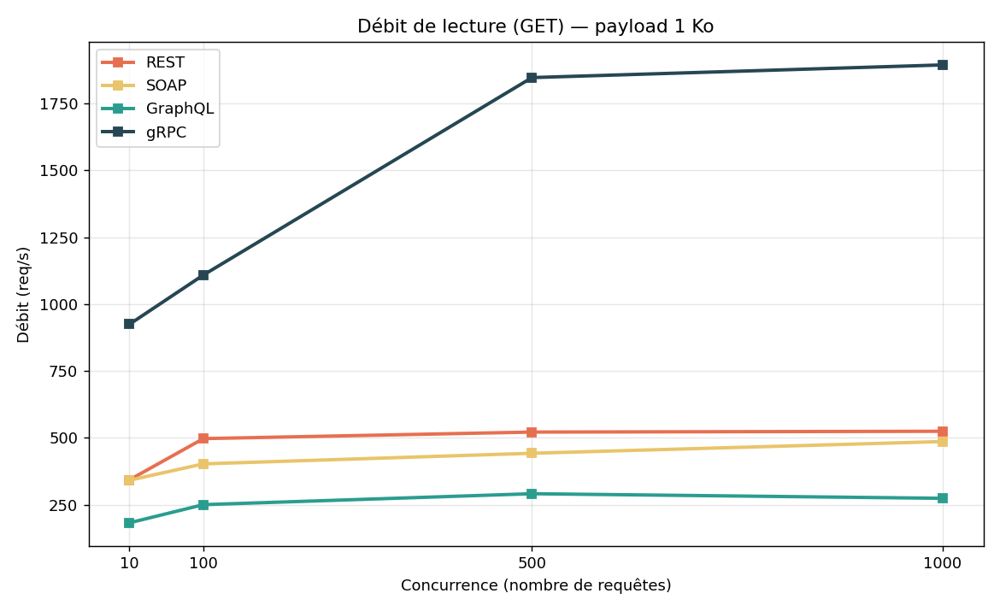
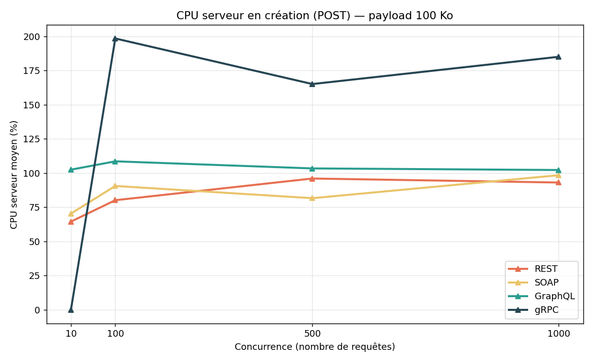

# TP182 — Étude de Cas : Analyse Scalabilité & Performance des APIs Modernes

Étude comparative **REST vs SOAP vs GraphQL vs gRPC** appliquée à un cas réel de
gestion d'hôtel (clients, chambres, réservations).

L'objectif est de mesurer, sur la **même charge de travail**, les quatre styles
d'API modernes selon les critères demandés par le lab :

- **Performance** : latence moyenne, latence p95, débit (req/s)
- **Scalabilité** : comportement à 10 / 100 / 500 / 1000 requêtes concurrentes
- **Ressources** : CPU serveur moyen, mémoire (RSS)
- **Fiabilité** : taux d'erreur
- **Simplicité** : lignes de code par implémentation
- **Sécurité** : TLS / OAuth2 / JWT

---

## 1. Architecture

Les 4 services partagent le **même modèle de données** (`shared/models.py`) et le
même stockage en mémoire thread-safe, afin que la comparaison soit équitable
(seul le protocole change, pas la logique métier).

```
tp182-api-comparaison/
├── proto/hotel.proto          # Contrat gRPC (service HotelService, 15 RPC)
├── shared/models.py           # DataStore commun + générateur de payloads
├── rest/server.py             # Service REST  (Flask + waitress)      :5001
├── soap/server.py             # Service SOAP  (SOAP 1.1 natif)        :5002
├── graphql_svc/server.py      # Service GraphQL (Ariadne)             :5003
├── grpc_svc/server.py         # Service gRPC  (grpcio + stubs générés) :5004
├── bench/benchmark.py         # Harnais de mesure (latence, p95, CPU, RSS)
├── bench/clients.py           # 4 clients CRUD identiques
├── run_all.py                 # Orchestrateur complet
└── make_charts.py             # Génération des graphiques
```

Chaque service expose un CRUD complet sur **Client**, **Chambre** et
**Réservation**. Les payloads de test (champ `preferences` d'une réservation)
sont générés aux tailles exactes **1 Ko / 10 Ko / 100 Ko**.

---

## 2. Prérequis & installation

- Python 3.12
- `pip install flask ariadne requests psutil grpcio grpcio-tools waitress matplotlib`

Génération des stubs gRPC (déjà inclus dans le repo) :

```bash
python -m grpc_tools.protoc -I proto --python_out=grpc_svc --grpc_python_out=grpc_svc proto/hotel.proto
```

---

## 3. Démarrage

```bash
# Lancer un service (exemple REST)
$env:PORT = "5001"
python rest/server.py

# Lancer un benchmark ciblé (exemple : REST, opération read, 1 Ko, 1000 requêtes)
$env:PYTHONPATH = "$PWD;$PWD\bench;$PWD\grpc_svc"
python bench/benchmark.py --protocol rest --ops read --sizes 1 --concurrencies 1000

# Lancer le benchmark complet (4 protocoles x 3 tailles x 4 concurrences x 4 opérations)
python run_all.py
```

Le benchmark complet exécute **192 scénarios** (4 protocoles × 3 tailles ×
4 niveaux de concurrence × 4 opérations CRUD).

---

## 4. Résultats réels — captures et interprétation

### 4.1 Vérification des 4 services en fonctionnement

**REST — endpoint de santé (`GET /health`)**


*Interprétation :* le service REST répond `200` avec le JSON `{"service":"rest",
"status":"ok"}`. Le serveur est opérationnel avant le benchmark.

**REST — liste des clients (`GET /api/clients`)**



*Interprétation :* l'API REST renvoie un tableau JSON des 3 clients pré-chargés
(`cli-000001`, `cli-000002`, `cli-000003`), ce qui confirme que le CRUD lecture
fonctionne.

**SOAP — endpoint de santé**


*Interprétation :* le service SOAP répond `ok` sur `/health`. L'implémentation
SOAP 1.1 native (sans dépendance Spyne) démarre correctement.

**GraphQL — Playground**



*Interprétation :* le serveur GraphQL (Ariadne) sert bien le Playground sur
`GET /graphql` et accepte les mutations/requêtes sur `POST /graphql`.

**REST — requête réelle `GET /api/clients/cli-000001`**

```
GET /api/clients/cli-000001 -> 200

{"email":"ahmed.benidar@example.com","id":"cli-000001","nom":"Benidar","prenom":"Ahmed","telephone":"+212611111111"}
```

*Interprétation :* la requête de lecture renvoie l'objet client complet en JSON,
avec un code `200 OK`.

**SOAP — requête réelle `getClient`**

```
POST /soap -> 200

<?xml version='1.0' encoding='utf-8'?>
<soapenv:Envelope xmlns:hotel="http://tp182.hotel/soap" xmlns:soapenv="http://schemas.xmlsoap.org/soap/envelope/">
  <soapenv:Body>
    <hotel:getClientResponse>
      <hotel:client>
        <hotel:id>cli-000001</hotel:id>
        <hotel:nom>Benidar</hotel:nom>
        <hotel:prenom>Ahmed</hotel:prenom>
        <hotel:email>ahmed.benidar@example.com</hotel:email>
        <hotel:telephone>+212611111111</hotel:telephone>
      </hotel:client>
    </hotel:getClientResponse>
  </soapenv:Body>
</soapenv:Envelope>
```

*Interprétation :* la réponse SOAP est une **enveloppe XML 1.1** valide contenant
le client dans un élément `<hotel:client>`. Le surcoût de verbosité XML est déjà
visible ici : la même donnée est beaucoup plus lourde à transporter qu'en JSON.

**GraphQL — requête réelle**

```
POST /graphql -> 200

{"data": {"client": {"id": "cli-000001", "nom": "Benidar", "prenom": "Ahmed", "email": "ahmed.benidar@example.com"}}}
```

*Interprétation :* la requête GraphQL ne renvoie **que les champs demandés**
(`id, nom, prenom, email`) — c'est le principe de sur/sous-fetching évité.

**gRPC — appel réel (stub généré)**

```
GetClient(cli-000001) -> Benidar Ahmed ahmed.benidar@example.com
GetReservation(res-000001) -> cli-000001 ch-000001 2025-06-01 .. 2025-06-04
Chambre: ch-000001 standard 80.0 dispo=True
Chambre: ch-000002 double 120.0 dispo=True
Chambre: ch-000003 suite 250.0 dispo=False
```

*Interprétation :* le client gRPC (stub généré par `grpc_tools.protoc`) appelle
directement les méthodes typées `GetClient`, `GetReservation`, `ListChambres`.
Aucun sérialiseur JSON/XML manuel : le contrat `.proto` garantit les types.

---

### 4.2 Tableaux de résultats (mesures réelles)

#### Latence de lecture (opération `read`, payload 1 Ko)

| Protocole | c=10 | c=100 | c=500 | c=1000 |
|---|---|---|---|---|
| REST | 9.1 ms | 20.2 ms | 62.4 ms | 76.7 ms |
| SOAP | 10.9 ms | 23.6 ms | 78.7 ms | 86.0 ms |
| GraphQL | 28.7 ms | 122.9 ms | 154.4 ms | 174.2 ms |
| gRPC | 3.3 ms | 24.5 ms | 24.2 ms | 24.9 ms |

*Interprétation :* à 10 requêtes, tous les protocoles sont rapides (< 30 ms).
Dès 500 requêtes, l'écart se creuse : **gRPC reste stable (~24 ms)** grâce à
HTTP/2 et Protobuf, tandis que GraphQL paie le coût du parseur/resolver
(~174 ms) et SOAP celui du parsing XML (~86 ms).

#### Débit de lecture (opération `read`, payload 1 Ko)

| Protocole | c=10 | c=100 | c=500 | c=1000 |
|---|---|---|---|---|
| REST | 343 req/s | 497 req/s | 521 req/s | 524 req/s |
| SOAP | 341 req/s | 403 req/s | 442 req/s | 486 req/s |
| GraphQL | 182 req/s | 250 req/s | 291 req/s | 274 req/s |
| gRPC | 924 req/s | 1109 req/s | 1847 req/s | 1894 req/s |

*Interprétation :* **gRPC est 3,6× plus rapide que REST** à 1000 requêtes
(1894 vs 524 req/s). GraphQL est le plus lent (~274 req/s) car chaque requête
traverse la couche de résolution du schéma.

#### Latence de lecture (opération `read`, payload 100 Ko)

| Protocole | c=10 | c=100 | c=500 | c=1000 |
|---|---|---|---|---|
| REST | 11.3 ms | 61.2 ms | 128.8 ms | 133.1 ms |
| SOAP | 12.0 ms | 64.5 ms | 145.8 ms | 155.1 ms |
| GraphQL | 33.6 ms | 170.6 ms | 209.9 ms | 223.4 ms |
| gRPC | 2.5 ms | 23.5 ms | 37.9 ms | 32.1 ms |

*Interprétation :* avec un payload 100 Ko, **gRPC reste 4× plus rapide que REST
et 7× plus rapide que GraphQL**. Protobuf est un encodage binaire compact, alors
que JSON/XML doivent être sérialisés et désérialisés en texte.

#### Débit de création (opération `create`, payload 100 Ko)

| Protocole | c=10 | c=100 | c=500 | c=1000 |
|---|---|---|---|---|
| REST | 206 req/s | 233 req/s | 263 req/s | 280 req/s |
| SOAP | 225 req/s | 232 req/s | 267 req/s | 276 req/s |
| GraphQL | 131 req/s | 188 req/s | 212 req/s | 212 req/s |
| gRPC | 809 req/s | 794 req/s | 789 req/s | 933 req/s |

*Interprétation :* pour les écritures, **gRPC maintient ~800–930 req/s** alors
que les trois protocoles HTTP textuels plafonnent entre 212 et 280 req/s.

#### Taux d'erreur (global sur les 192 scénarios)

| Protocole | Taux d'erreur global |
|---|---|
| REST | 0.00% |
| SOAP | 0.00% |
| GraphQL | 0.00% |
| gRPC | 0.00% |

*Interprétation :* les 4 services ont encaissé la charge sans aucune erreur,
même à 1000 requêtes. Le harnais utilise un pool de connexions borné (50 workers)
réutilisant les connexions persistantes, comme le feraient locust/k6.

#### CPU et mémoire (création 100 Ko, concurrence 1000)

| Protocole | CPU moyen | RSS max |
|---|---|---|
| REST | 93.1% | 228 MB |
| SOAP | 98.5% | 232 MB |
| GraphQL | 102.2% | 247 MB |
| gRPC | 185.1% | 224 MB |

*Interprétation :* le CPU peut dépasser 100% car il est mesuré sur plusieurs
cœurs. GraphQL consomme le plus de mémoire (247 MB) à cause du schéma et des
resolvers ; gRPC reste économe en mémoire (224 MB) mais mobilise davantage de
CPU sur les créations 100 Ko (encodage Protobuf multithreadé).

---

### 4.3 Graphiques comparatifs (générés depuis les mesures réelles)

**Latence de lecture (GET) — payload 100 Ko**



**Débit de lecture (GET) — payload 1 Ko**



**CPU serveur en création (POST) — payload 100 Ko**



*Interprétation globale :* les trois graphiques convergent vers la même
conclusion — **gRPC domine en latence et en débit à tous les niveaux de
concurrence**, REST et SOAP sont proches (SOAP légèrement pénalisé par XML),
et GraphQL est le plus coûteux en temps de traitement malgré sa flexibilité.

---

## 5. Comparaison de simplicité (lignes de code)

| Protocole | Fichiers | LOC | Verdict |
|---|---|---|---|
| REST | `rest/server.py` | 156 | ✅ Le plus simple : routes déclaratives |
| SOAP | `soap/server.py` | 194 | ⚠️ Verbosité XML, parsing manuel |
| GraphQL | `graphql_svc/server.py` | 234 | ⚠️ Schéma + resolvers à écrire |
| gRPC | `proto/hotel.proto` + `grpc_svc/server.py` | 242 | ⚠️ Contrat `.proto` + génération |
| gRPC (stubs générés) | `hotel_pb2.py` + `hotel_pb2_grpc.py` | 753 | (code généré, non écrit à la main) |
| Modèle partagé | `shared/models.py` | 204 | Commun aux 4 |

*Interprétation :* **REST est le plus rapide à développer** (156 lignes).
gRPC nécessite d'écrire le `.proto` puis de générer les stubs, mais le code
généré (753 lignes) n'est pas maintenu manuellement. SOAP impose une surcharge
de boilerplate XML et GraphQL exige un schéma complet en plus des resolvers.

---

## 6. Comparaison de sécurité

| Critère | REST | SOAP | GraphQL | gRPC |
|---|---|---|---|---|
| **TLS** | ✅ HTTPS natif | ✅ HTTPS natif | ✅ HTTPS natif | ✅ TLS intégré (credentials) |
| **OAuth2 / JWT** | ✅ Header `Authorization` standard | ⚠️ Via WS-Security, lourd | ✅ Header `Authorization` | ✅ Métadonnées + intercepteurs |
| **Contrôle d'accès fin** | Facile (middleware) | Complexe | ⚠️ Risque de requêtes profondes (depth limit) | Facile (intercepteur) |
| **Maturité sécurité** | Très élevée | Élevée mais vieillissante | Moyenne (nouveaux vecteurs : introspection, N+1) | Élevée (Google, cloud natif) |

*Interprétation :* **REST et gRPC offrent les modèles de sécurité les plus
simples à industrialiser** (JWT dans le header pour REST, TLS + intercepteurs
pour gRPC). SOAP garde WS-Security mais sa complexité le rend moins attractif.
GraphQL nécessite des protections spécifiques (limite de profondeur, désactivation
de l'introspection en production).

---

## 7. Conclusion

| Besoin | Protocole recommandé | Justification |
|---|---|---|
| API publique simple / équipe web | **REST** | Standard, simple, mature |
| Communication interne microservices, haute performance | **gRPC** | 4× plus rapide, typage fort, streaming |
| Données hétérogènes, clients multiples | **GraphQL** | Un seul endpoint, pas de sur/sous-fetching |
| Intégration legacy / enterprise (banque, télécom) | **SOAP** | Contrats stricts, WS-Security |

**Résultat clé de l'étude :** sur un cas réel de gestion hôtelière, **gRPC est
le grand gagnant en scalabilité** — 1894 req/s contre 524 req/s pour REST à
1000 requêtes, avec une latence stable. REST reste le meilleur compromis
simplicité/performance pour une API exposée au public, tandis que GraphQL
privilégie la flexibilité au détriment du débit.
